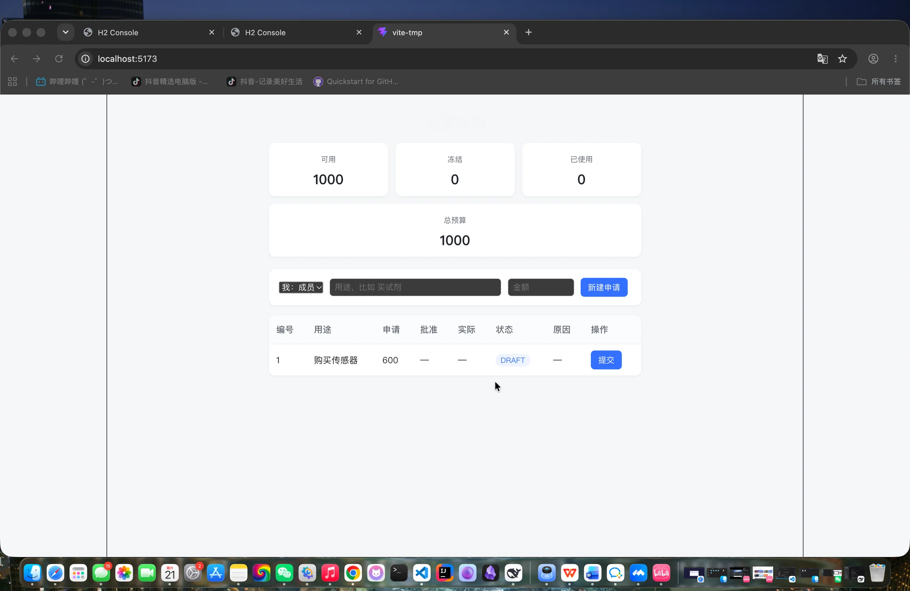
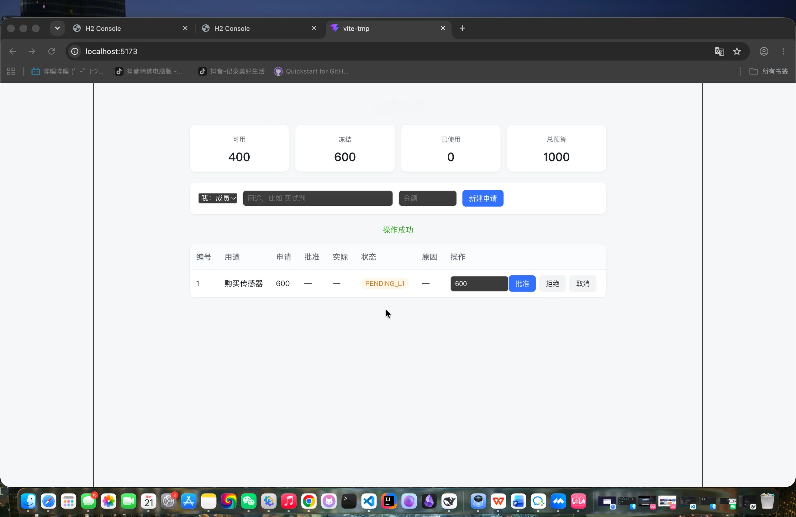
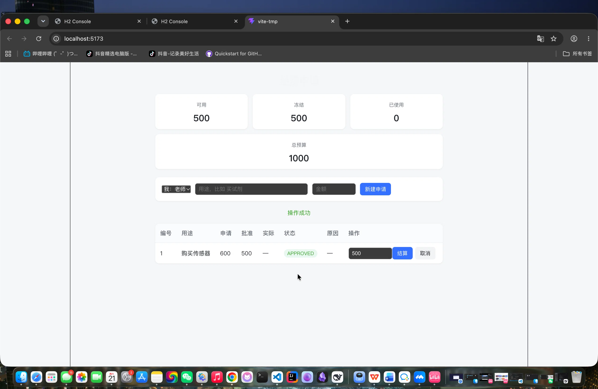
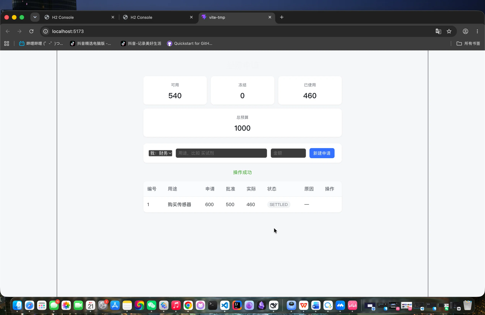

# 前端工程

你在浏览器里看到的页面，以及点击、输入后的反应，都属于前端的工作。这里放的是本项目的 Vue 工程。项目流程和 Git 规范见[根 README](../README.md)。

## 当前工程

| 项目 | 实际值 |
|---|---|
| 框架 | Vue 3.5 |
| 语言 | JavaScript（未使用 TypeScript） |
| 构建工具 | Vite 8.3 |
| 开发端口 | 5173 |
| 后端地址 | `http://localhost:8080`（通过 Vite 代理转发） |
| 登录态 | 登录后拿到 token，存 `localStorage`，请求带 `X-Token` 头 |

目录约定：

- `index.html`：页面入口，挂载 `src/main.js`
- `src/App.vue`：唯一页面（未登录显示登录框，登录后显示经费卡片 + 新建表单 + 申请表格）
- `src/main.js`：创建 Vue 应用
- `vite.config.js`：含开发代理配置
- `dist/`：构建产物，已被忽略
- `node_modules/`：依赖目录，已被忽略，不提交

## 启动与验证

命令都在 `frontend/` 目录执行：

```bash
cd frontend
npm install        # 首次执行，安装依赖
npm run dev        # 启动开发服务器
```

启动后终端出现 `Local: http://localhost:5173/`，浏览器打开该地址。

页面要能显示数据，**后端必须同时在跑**（`backend/` 下 `./mvnw spring-boot:run`，监听 8080）。前端的 `/api/...` 请求由 Vite 代理转发到 8080，浏览器不会遇到跨域问题。

验证页面真的取到了数据：

1. 用 `member1 / 123456` 登录（账号见 `backend/README.md`）；
2. 顶部四张卡片显示金额，表格列出申请；
3. 浏览器按 `F12` → `Network`，刷新页面，能看到 `api/project` 与 `api/applications` 两条请求，状态均为 `200`。

## 页面功能

- **登录页**：用户名 + 密码；失败显示后端返回的原因（如“用户名或密码错误”）。
- **顶部**：当前用户名和角色，右侧“退出”按钮。
- **金额卡片**：可用、冻结、已使用、总预算。
- **新建申请**：只有成员看得到表单，填用途和金额创建草稿。
- **申请表格**：编号、用途、申请金额、批准金额、实际金额、状态、原因。
- **按角色与状态显示操作**：
  - 成员 + 草稿：提交
  - 老师 + 待审批：批准、拒绝
  - 财务 + 已批准：结算
  - 成员 + 待审批或已批准：取消
- **失败提示**：后端返回的原因直接显示（401 会自动退回登录页）。

## 演示流程（实际截图）

一条 600 元申请，从提交到结算的四个状态，与需求文档里的数字逐格一致：

| 步骤 | 可用 | 冻结 | 已使用 | 状态 |
|---|---:|---:|---:|---|
| 起点 | 1000 | 0 | 0 | DRAFT |
| 成员提交 | 400 | 600 | 0 | PENDING_L1 |
| 老师批准 500 | 500 | 500 | 0 | APPROVED |
| 财务结算 460 | 540 | 0 | 460 | SETTLED |









## 构建

```bash
cd frontend
npm run build      # 产物输出到 dist/
npm run preview    # 本地预览构建结果
```

## 尚未完成

- 只支持一个项目，没有项目切换。
- 列表没有分页、搜索。
- 没有“修改密码”“注册”等功能。
- 未做构建产物的部署验证（只验证过 `npm run build` 能成功产出 `dist/`）。

## 官方入口

- [Vue 入门与工程创建](https://cn.vuejs.org/guide/quick-start.html)
- [Vite 官方说明](https://vite.dev/guide/)
